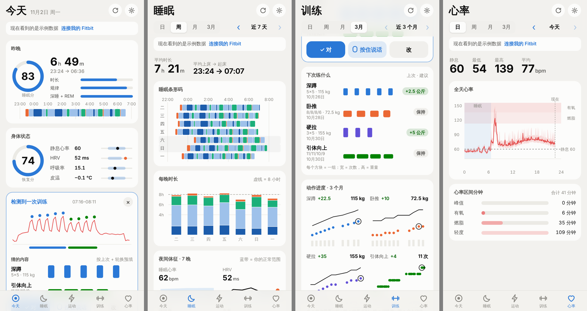

# 我的健康（Fitbit 自用 iPhone app）

一个只给自己用的主屏幕网页 app，直接从 Google Health API 读取 Fitbit 数据，图为主、字为辅。
五个页面共用一个 **日 / 周 / 月 / 3个月** 切换，左右滑动或点右上角的箭头看更早或更近的时间段。
界面是黑白的，颜色只用在数据上；橙色只表示“比你的正常范围差”。

- **今天**：待确认的训练、睡眠分和恢复分（各带一句原因）、昨晚、身体状态（静息心率、HRV、呼吸率、皮温和你的正常范围）、下次练什么、今天的运动、步数（和你平时到这个钟点的步数比）
- **睡眠**：日 = 一晚的分期叠夜间心率和夜间体征；周 / 月 = 每晚几点睡几点起、睡够没有；3 个月 = 每周时长和上床时间的变化
- **运动**：日 = 每次运动的心率和中高强度分钟；周 = 每天的中高强度和运动列表；月 = 运动日历；3 个月 = 每周时长和有氧能力（VO2 max）
- **力量**：练完不用点开始结束。app 从心率和步数里找出力量训练，猜你练了什么（按上次 + 轮换），打开就能确认；
  不对就点“说”，用 iPhone 键盘上的 🎤 说一句（“深蹲 100 公斤 5 组 5 个，引体 4 组 8 个，最后一组很吃力”），手机直接读懂，或者手动改。
  还有“下次练什么”、每个动作每次最重的一组、练了哪些部位、训练日历、每周组数
- **心率**：日 = 静息心率、HRV 和全天心率曲线（睡觉和运动标在上面）；周 / 月 / 3 个月 = 静息心率和 HRV 的趋势和你的正常范围

没连接之前显示示例数据，可以先把每个页面都看一遍。

## 想自己用？

谁都可以用，不用写代码，也不用付钱给我。数据只在你的手机和你自己的 Google 账号之间走，我这边看不到。你需要：

- 一块 Fitbit，账号已经在 Google Health / Fitbit app 里迁移到 Google 账号
- 一台 iPhone（Android 用 Chrome 也能装到桌面，没测过）
- 一个你自己的 Google Cloud 项目（免费），用来拿到 Client ID 和 Client Secret

两种用法，选一种：

- **直接用我放好的网址**：`https://huiskylabs.github.io/open-fitbit/`。下面第 2 步的回调地址就填这个网址。
- **fork 一份自己放**：fork 这个仓库 → Settings → Pages 选 `main` 分支根目录，网址会是 `https://你的用户名.github.io/open-fitbit/`，回调地址填你自己的网址。这样代码完全在你手里，我改代码不会影响你。

### 拿 Client ID（只做一次，大约 15 分钟）

1. 打开 [Google Cloud Console](https://console.cloud.google.com/)，新建一个项目（名字随便）。
2. **API 和服务 → 库**：搜 *Google Health API*，启用；再搜 *Google Drive API*，启用（训练记录备份用）。
3. **Google Auth Platform**（OAuth 同意屏幕）：
   - 品牌塑造：填个 app 名字和你的邮箱
   - 受众群体：选 *外部（External）*，在 *测试用户* 里加上你自己的 Gmail
   - 数据访问：添加上面“用到的 Google 权限”里的三个 `googlehealth` 权限
4. **客户端 → 创建客户端**：类型选 *Web 应用*，在 *已获授权的重定向 URI* 里填你用的那个网址（结尾的 `/` 也要有）。
5. 创建完会显示 Client ID 和 Client Secret，当场复制或下载保存（Secret 之后可能看不到完整的）。

然后按下面“安装步骤”的第 3 步开始：加到主屏幕，在 app 设置里填这两个值，用 Google 账号授权。授权时看到“Google 未验证此应用”是正常的，因为这是你自己的项目，点“继续”。

## 分数怎么算

- **睡眠分**（0–100）= 时长 50（4 小时 0 分，8 小时满分）+ 规律 25（上床和起床时间跟前 7 晚的中位数比）+ 深睡和 REM 占比 25（40% 以上满分）
- **恢复分**（0–100）= HRV 跟你 30 天基线比 35 + 静息心率跟基线比 30 + 睡眠分 35；呼吸率或皮温明显偏高各扣 8 分
- **正常范围** = 前 30 天的平均值 ± 1.5 个标准差（大约 15 天里有 1 天会落在不好的那一侧之外，所以标出来的才值得看）；API 直接给了个人范围时用 API 的

## 架构

纯静态网页（HTML/CSS/JS，无依赖、无构建、无服务器）。手机上的浏览器直接用 Google OAuth（授权码 + PKCE）登录，再直接调用 `https://health.googleapis.com/v4`。
最近 120 天的数据存在手机的 IndexedDB 里，打开时只更新最近几天，每周完整重新下载一次。

密钥都只存在这台 iPhone 上，代码仓库里没有任何密钥，所以仓库公开也没关系：

- Google 的 Client ID / Secret 和登录令牌
- （可选）OpenRouter 或 Anthropic 的 API 密钥：只有手机读不懂的那句话才会发给模型

用到的 Google 权限：

- `googlehealth.sleep.readonly`
- `googlehealth.activity_and_fitness.readonly`
- `googlehealth.health_metrics_and_measurements.readonly`
- `drive.file`（训练记录备份；只能看到这个 app 自己建的那一个备份文件）

Google Health API 只接受只带 Google Health 权限的令牌（混进 Drive 权限会返回 403 `DISALLOWED_OAUTH_SCOPES`），
所以 app 给读 Fitbit 数据和备份各用一个令牌，每个令牌只带自己需要的权限。训练记录不会写回 Google Health。

## 安装步骤

1. **放到网上**：仓库 Settings → Pages 里选 `main` 分支根目录。网址是 `https://huiskylabs.github.io/open-fitbit/`。
2. **Google Cloud 里加回调地址**：Google Cloud Console → APIs & Services → Credentials → 你的 OAuth 客户端（Web application），在 *Authorized redirect URIs* 里加上上面那个网址（结尾的 `/` 也要一致）。
   同时确认 *OAuth consent screen → Data Access* 里勾了上面三个 Google Health API 权限，*Audience → Test users* 里有你自己的 Gmail。
3. **装到 iPhone**：用 Safari 打开网址 → 分享按钮 → **添加到主屏幕**。
4. **连接 Fitbit**：从主屏幕打开 app → 右上角设置 → 填 Client ID 和 Client Secret → **保存并连接** → 用你的 Google 账号授权。
   - 如果授权后跳到了 Safari 而不是回到 app：复制 Safari 地址栏里的完整网址，回到 app 的设置里，展开“登录后跳回了 Safari？”，粘贴后点“完成连接”。
5. **语音记录训练**：不用设置。确认卡或训练编辑里点“说”，再点键盘上的 🎤 说一句，边说边能看到 app 听懂了什么，说完点“好了”。
   主屏幕 app 里 iOS 不让网页直接用语音识别，所以用键盘听写，它就是 iPhone 自带的语音输入。用 Safari 打开网页时可以按住按钮说。
   常见说法（动作、重量、组数、每组次数、“最后一组很吃力”、“第二组 95”、“没练硬拉”、“再加一组引体”）都在手机上直接读懂。
   可选：设置 → 语音记录 → 填 OpenRouter（`sk-or-…`）或 Anthropic（`sk-ant-…`）的密钥，选 Haiku（便宜）或 Sonnet。之后手机读不懂的句子会交给模型。
6. **训练记录备份到 Google Drive**（默认就开着）：在 Google Cloud 项目里启用一次 **Google Drive API**（没启用时 app 顶部会提示，点“去启用”直接到那个页面）。
   连接 Fitbit 时 Google 会一起问 Drive 权限，勾上就行；没勾的话 app 顶部会提示“授权”。之后每次保存训练都会更新 Drive 里的“我的健康 训练记录备份.json”；
   换手机后连接 Fitbit，会自动从备份恢复。设置里也可以随时导出 JSON 文件。
7. **保持一直连着**：Google 项目在“测试”状态下登录令牌 7 天过期，到时 app 顶部会提示，点“重新连接”即可（手机上的数据不会丢）。
   想不再过期：Google Cloud → Google Auth Platform → Audience → **Publish app**（不用提交审核），然后在 app 里重新连接一次。

## 许可证

MIT，见 [LICENSE](LICENSE)。

## 文件

- `index.html` / `styles.css` / `app.js`：外壳（标签页、日 / 周 / 月 / 3个月 切换、同步、设置）
- `js/pages/`：五个页面（today、sleep、workouts、trainpage、heart）和共用部分
- `js/charts.js` / `js/tcharts.js`：所有图（纯 SVG，颜色跟随浅色 / 深色模式）
- `js/data.js` / `js/store.js`：本机缓存、同步、基线
- `js/scores.js`：睡眠分、恢复分、心率区间
- `js/training.js`：训练识别、猜测、进度计算
- `js/trainui.js`：训练编辑和语音输入
- `js/sayparse.js`：把说的话变成动作、组数和重量（在手机上，不联网）
- `js/voice.js`：语音识别（Safari 里），和可选的 AI 解析（OpenRouter / Anthropic）
- `js/drive.js`：Google Drive 备份
- `js/auth.js` / `js/api.js`：Google 登录和 Google Health API
- `js/demo.js`：示例数据
- `sw.js` / `manifest.webmanifest` / `icons/`：主屏幕 app 和离线打开
